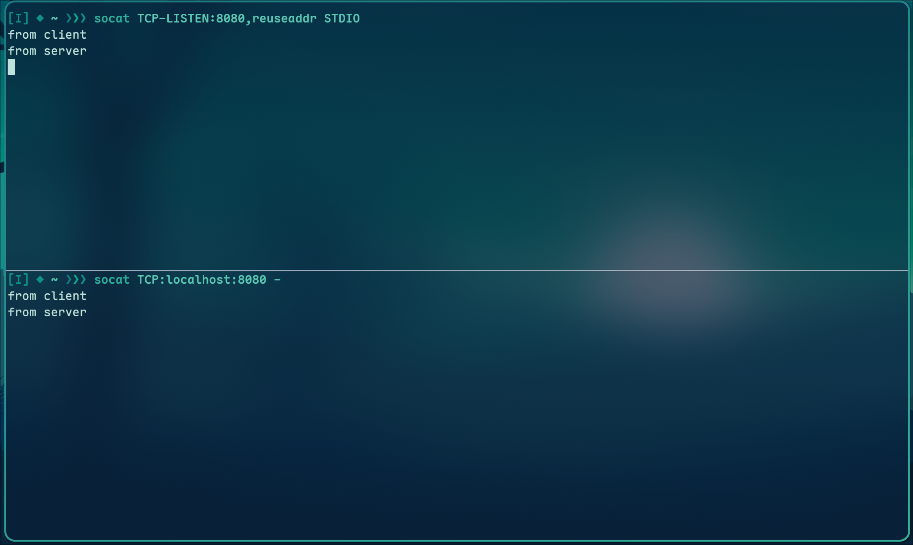
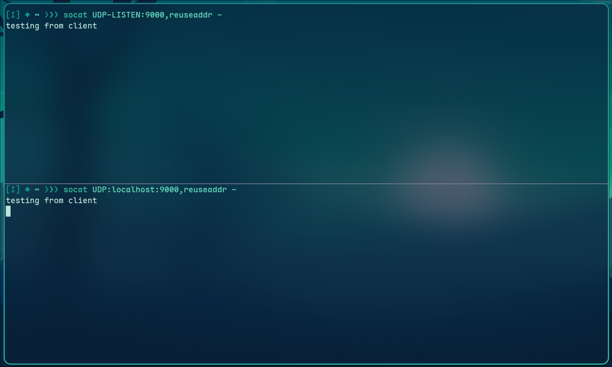
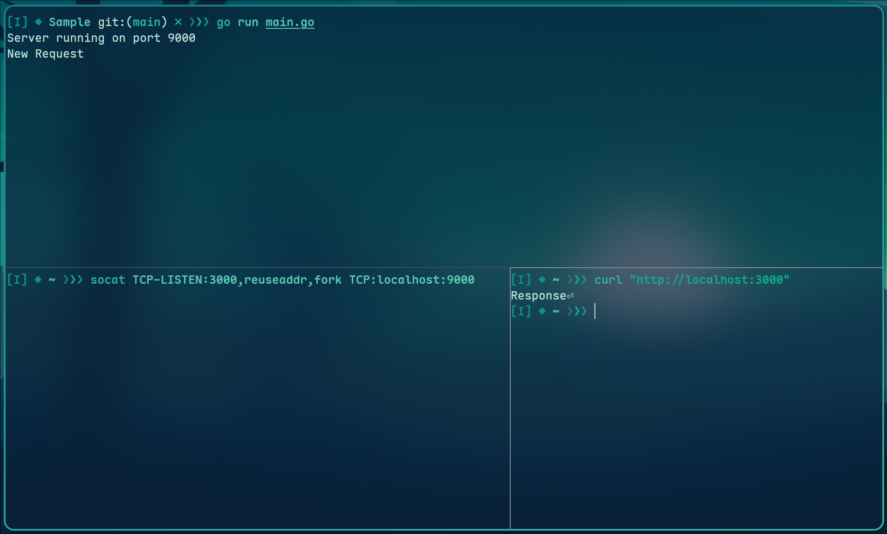

Hey, welcome to my blog!

This is my first blog post, so there might be some mistakes or things that could be explained better. If you find anything incorrect or have suggestions to improve the post, I'd be happy to hear your feedback. Feel free to reach out to me via email or Discord.

In this post, we'll be exploring **Socat**, a versatile command-line utility for network communication. We'll go through its basic usage and look at some practical examples of how it can be used.
## What is socat ?

Socat ( short for SOcket CAT ) is a command line utility used for bidirectional data transfer between two data streams or endpoints. It can connect / transfer data between any kind of data channels such as sockets, pipes, files, serial ports or programs.

## Installation

Socat works across multiple operating system especially POSIX/UNIX based systems. On Windows you can use socat either using WSL or can run inside Cygwin. Another alternative method is to use Go port of [socat](https://github.com/oittaa/socat/) ( Not Recommended ).

You can install socat in macOS using homebrew and their respective package manager in Linux distros.

#### Debian

To install socat on debian based distros run

```bash
sudo apt install socat
```

#### Arch Linux

You can install socat in Arch Linux using pacman

```bash
sudo pacman -S socat
```

#### RHEL / Fedora / Rocky

To install socat on Fedora / Red Hat based distributions

```bash
sudo dnf install socat
```

## Socat syntax

In this section, we will look at socat's command syntax, its available usage and some practical examples.

```bash
socat [options] <address1> <address2>
```

Socat takes two addresses as main argument that represents the endpoint between which data is transfered.
Global options are specified before the addresses and those are applied for the whole connection.

Each address are in format similar to:
```bash
TYPE:parameters,options
```

* **TYPE**: Specify the type of address such as TCP, UDP, TCP-LISTEN, or FILE etc.
* **Paramenters**: Provide required details for the address such as IP Adress, Port number or file path.
* **Options**: Used to configure the behavior of a specific address.

<br>

### Global Options

Global options controls the overall behavior of socat. That includes logging, debugging and data transfer.

|Option|Description                                                     |
|------|----------------------------------------------------------------|
|-d    |Displays diagnostic messages, Repeat to increase the verbosity  |
|-v    |Displays transfered data in readable format                     |
|-x    |Displays transfered data in hexadecimal format                  |
|-u    |Enable unidirectional data transfer from first address to second|
|-U    |Enable unidirectional data transfer from second address to first|
|-4    |Use IPv4 when address don't specify IP version                  |
|-6    |Use IPv6 when address don't specify IP version                  |

<br>

### Address Types

Socat supports different address types that allow it to communicate with network sockets, files, processes, and other endpoints.

|Address Type |Description                                                           |
|-------------|----------------------------------------------------------------------|
|STDIO        |Uses standard input and standard output as the communication endpoint.|
|-            |Shorthand for STDIO                                                   |
|TCP:         |Establishes a TCP connection to the endpoint                          |
|UDP:         |Establishes a UDP connection to the endpoint                          |
|TCP-LISTEN:  |Creates a TCP listening socket                                        |
|UDP-LISTEN:  |Creates a UDP listening socket                                        |
|OPENSSL:     |Establishes connection using SSL/TLS                                  |
|FILE:        |Reads from or write to files                                          |
|EXEC:        |Executes a program and communicate through standard I/O               |
|SYSTEM:      |Run a command through Shell                                           |
|UNIX-CONNECT:|Connects to UNIX Domain socket                                        |
|UNIX-LISTEN: |Listens to UNIX Domain socket                                         |

<br>

### Address Options

Address specific options are used to configure individual endpoints.

|Option   |Description                                      |
|---------|-------------------------------------------------|
|fork     |Create child process for each incoming connection|
|bind     |Specifies the local IP address to bind the socket|
|keepalive|Enable TCP keepalive on socket                   |
|reuseaddr|Allows local socket address to be reused         |

<br>

### Socat Usage Examples

There are many use cases for socat. In this section we will look into few simple uses of socat.

#### 1. TCP Server & Client

In this example, we will create a simple TCP server and connect to it using a client. Both the server and client will be created using Socat.

TCP establishes a connection between the client and server before data transfer begins. Once connected, data can be transmitted in both directions through the connection.

**Terminal 1 - TCP Server**
```bash
socat TCP-LISTEN:8080,reuseaddr STDIO
```
***Note**: `STDIO` represents standard input and standard output (stdin and stdout) of the terminal, which Socat uses as one of the communication endpoints.*

This will start a TCP server that will listen to TCP requests on port `8080`.

**Terminal 2 - TCP Client**

```bash
socat TCP:localhost:8080 -
```

***Note**: - is a shorthand for `STDIO`*

This will be acting as TCP client and will make connection to TCP  server.



##### Handle multiple connections at same time

One drawback of current TCP server is that it can only handle one connection at a time. 

To overcome this limitation, we can add the `fork` option to the first address. This allows Socat to create a new child process whenever a new TCP connection is received, allowing it to handle multiple connections simultaneously.


The new LISTENER command will look like this:
```bash
socat TCP-LISTEN:8080,reuseaddr,fork STDIO
```

#### 2. UDP Communication

In this example, we will use socat to communicate over UDP protocol.

Unlike TCP, UDP does not establish a connection before sending data. It sends datagrams directly to the destination, without guaranteeing delivery, ordering, or retransmission.

**Terminal 1**

```bash
socat UDP-LISTEN:9000,reuseaddr -
```

This starts listening for incoming UDP datagrams on port `9000`.

**Terminal 2**

```bash
socat UDP:localhost:9000,reuseaddr -
```

This sends UDP datagrams to the listener running on port `9000`.



#### 3. TCP port forwarding

In this example, we will forward a TCP port using socat.

Lets imagine there is a service running locally on port `9000`, you want to expose or forward that port through port `3000`.

##### Example

To demonstrate this properly we will run a simple Go backend server on port `9000` that will print `New Request` when the Go server receives new request.

**main.go**

```go
package main

import (
	"fmt"
	"net/http"
)

func handleIndex(w http.ResponseWriter, r *http.Request) {
	fmt.Println("New Request")
	w.WriteHeader(200)
	w.Write([]byte("Response"))
}

func main() {
	http.HandleFunc("/", handleIndex)

	fmt.Println("Server running on port 9000")

	http.ListenAndServe(":9000", nil)
}
```

***Note:** You can use any language, just need a simple http server that sends a response to the request*

**Terminal 1**

First we will run this simple HTTP server on port 9000.

```bash
go run main.go
```

**Terminal 2**

```bash
socat TCP-LISTEN:3000,reuseaddr,fork TCP:localhost:9000
```

This will start TCP listener on port `3000` and will forward every request that is received on it to the service that is running in port `9000`.
 
**Terminal 3**

```bash
curl "http://localhost:3000"
```
This will make a request to `http://localhost:3000` and we will see if that request is being forwarded to the HTTP server running on port `9000` or not.



As you can see even though the curl request we made was to port `3000`, our HTTP server running on port `9000` receives it and was able to send response successfully. This means socat is forwarding port correctly.

## Conclusion

Socat is a versatile command-line utility that makes it easy to establish communication between different endpoints. From creating simple TCP and UDP connections to forwarding ports, it provides a flexible way to work with network communication without requiring complex configurations.

These examples cover some of the basic uses of Socat, but its capabilities extend far beyond this. It can also be used for tunneling, connecting UNIX domain sockets, transferring files, interacting with network services, and much more. Understanding how Socat works can be useful when troubleshooting networks, testing services, and exploring different communication protocols.
